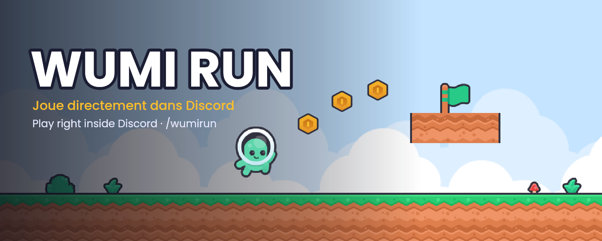
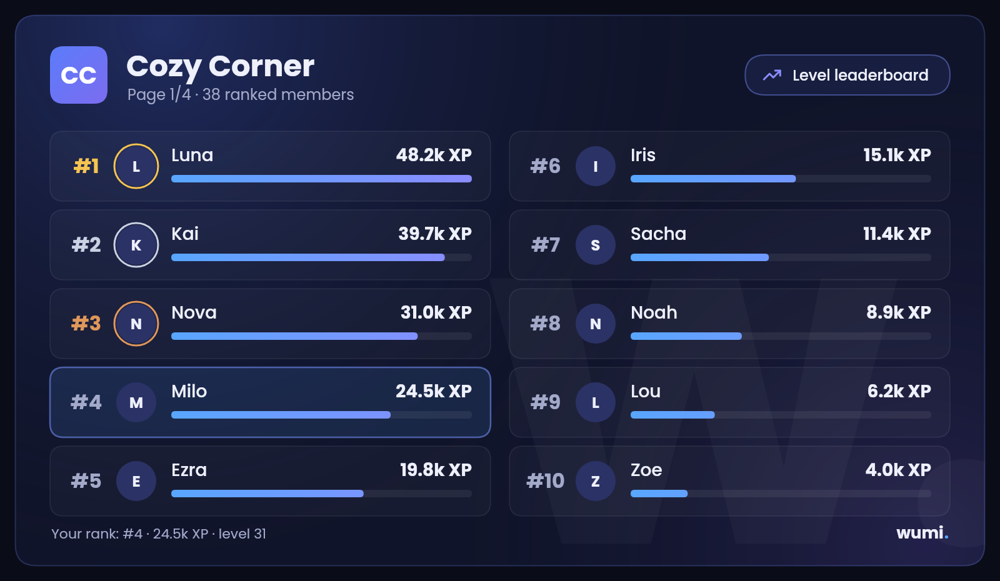
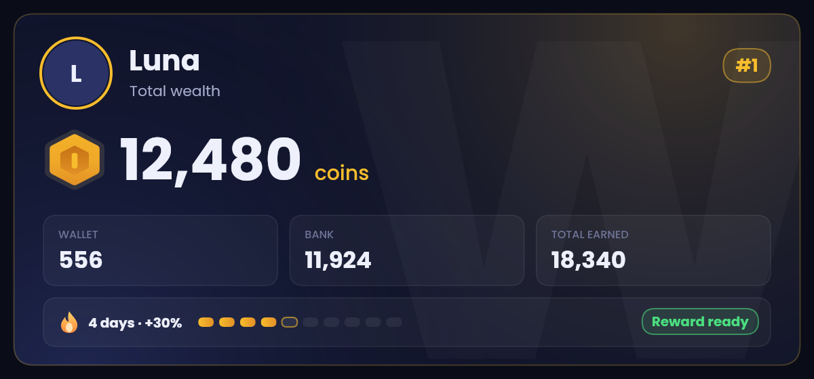
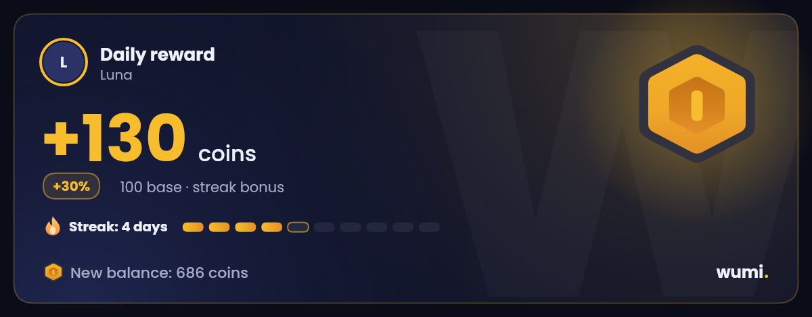
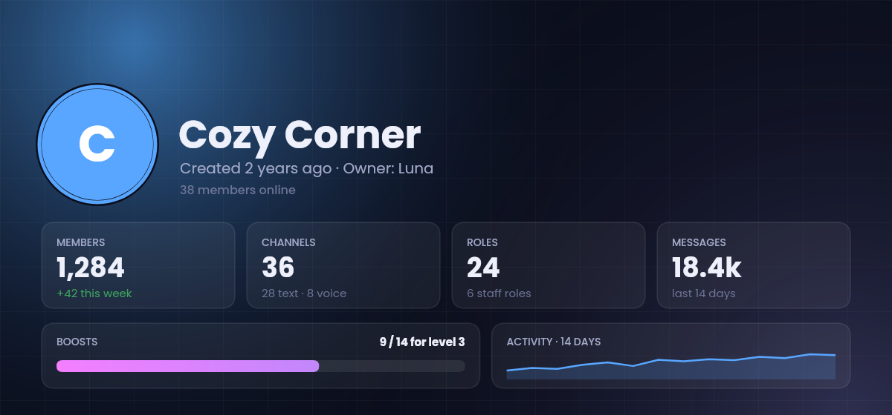
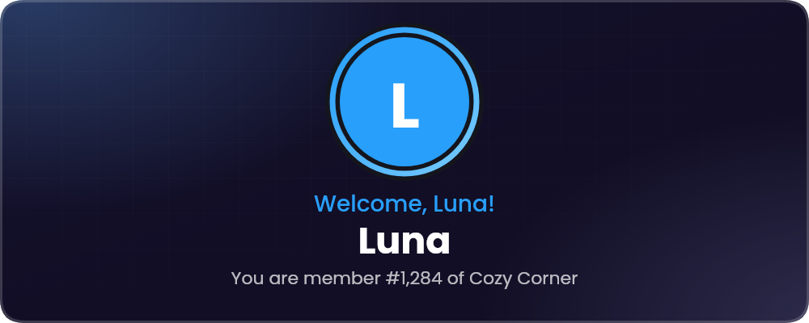

<div align="center">


<br>

[English](README.md) · **Français**

<br>

[](https://discord.com/oauth2/authorize?client_id=1545770920185045084&scope=bot%20applications.commands&permissions=1426362592470)
[](https://wumi.fr/fr/)
[](https://discord.gg/VaGrXgnAHS)


</div>

---

**Wumi** est un bot Discord tout-en-un : il accueille les nouveaux, protège ton serveur, récompense les habitués, joue de la musique, gère tes tickets, et il a même son propre jeu, qui se joue directement dans Discord. Tout passe par les commandes slash, chaque message suit la langue du serveur (français ou anglais), et il ne demande jamais la permission Administrateur.

## ✨ Les points forts

<table>
<tr>
<td width="50%" valign="top">

### 🎮 Wumi Run
Un vrai jeu de plateforme, lancé avec `/wumirun jouer` en Activité Discord. 5 niveaux, des pièces, des étoiles, des personnages à débloquer et un classement des meilleurs temps sur chaque serveur.

</td>
<td width="50%" valign="top">

### 🛡️ Anti-nuke
Si un admin ou un bot supprime des salons ou des rôles, ou bannit en rafale, Wumi lui retire ses rôles aussitôt et envoie au propriétaire un rapport pour tout réparer.

</td>
</tr>
<tr>
<td valign="top">

### 🪙 Économie
Récompense quotidienne avec série, travail, banque, boutique et missions. Chaque réponse est une carte en image, avec des boutons rapides en dessous.

</td>
<td valign="top">

### 📈 Niveaux
De l'XP pour les messages et le vocal, des cartes de rang, des classements en image, des badges, le prestige et un `/wrapped` chaque mois.

</td>
</tr>
<tr>
<td valign="top">

### 🎫 Tickets et modmail
Prise automatique à la première réponse du staff, alerte quand un ticket reste sans réponse, transcriptions, notes et `/ticket stats`. Un MP à Wumi pour joindre l'équipe.

</td>
<td valign="top">

### 🔨 Modération
Clic droit sur un membre › **Sanctionner**, avertissements avec paliers automatiques, automod, anti-raid, anti-phishing et journaux traduits qui disent qui a fait quoi.

</td>
</tr>
</table>

## 🖼️ Un aperçu

<div align="center">

<sub><b>Wumi Run</b> : le jeu de plateforme qui s'ouvre directement dans ton salon.</sub>
<br><br>

<sub><code>/classement</code> : deux colonnes, des barres de progression, ta ligne mise en avant.</sub>
<br><br>
 
<sub><code>/economie solde</code> et <code>/economie daily</code>, avec la pièce d'or de Wumi Run.</sub>
<br><br>
 
<sub><code>/serverinfo</code> et une carte de bienvenue (jusqu'à 5 designs personnalisés par serveur).</sub>
</div>

## 📚 Tout ce que Wumi sait faire

| Catégorie | Au programme |
|---|---|
| 🎮 **Jeux** | Wumi Run (Activité Discord), puissance 4, morpion, pendu, quiz des drapeaux et culture générale, blind test, salon de comptage, `/pet`, `/lfg` |
| 🪙 **Économie** | Récompense quotidienne avec bonus de série, travail, banque avec intérêts, boutique avec rôles, objets, missions, `/payer`, `/braquer`, classement |
| 📈 **Niveaux** | XP (messages et vocal), cartes de rang et de profil, thèmes, badges, prestige, rôles par palier, classement mondial, `/wrapped` |
| 🔨 **Modération** | avertir, muet, expulser, bannir, softban, massban, purge, verrouillage, mode lent, historique, notes du staff, appels, `/snipe`, sanction au clic droit |
| 🛡️ **Sécurité** | `/antinuke`, bouton panique `/raid`, anti-raid, automod, anti-phishing, `/audit` (note sur 100), photos de structure et réparation |
| 🎫 **Support** | Tickets avec panneaux, prise en charge et transcriptions, modmail, suggestions avec votes, candidatures du staff |
| 👋 **Communauté** | Cartes de bienvenue et d'au revoir, rôles automatiques, rôles-réactions, starboard, anniversaires, concours avec chances bonus, événements récurrents |
| 🎵 **Musique** | `/play` (YouTube, Spotify, SoundCloud), radios, filtres, rôle DJ, playlists, 24/7 |
| 🧰 **Utilitaires** | Créateur d'`/embed` avec modèles, fiches serveur et membre, `/stats` avec rapport du lundi, suivi des invitations, vocaux temporaires, alertes Twitch / YouTube / RSS |

> La liste complète, toujours à jour, est sur **[wumi.fr/commandes](https://wumi.fr/commandes/?lang=fr)** : elle est générée à partir du bot lui-même.

## 🚀 L'héberger soi-même

**Il te faut :** Node.js **22.5 ou plus** (24 conseillé) et une application Discord créée sur le [Developer Portal](https://discord.com/developers/applications).

```bash
git clone https://github.com/WumiTeam/Wumi-Bot.git
cd Wumi-Bot
npm install
cp .env.example .env      # puis remplis DISCORD_TOKEN, CLIENT_ID, OWNER_IDS...
npm run deploy            # enregistre les commandes slash
npm start
```

- La base de données est **SQLite intégrée à Node** : rien à compiler, rien à installer.
- Chaque variable est expliquée dans [`.env.example`](.env.example).
- En production, utilise [PM2](https://pm2.keymetrics.io/) avec `ecosystem.config.js`, ou `scripts/windows/demarrer.bat` sous Windows.
- Les services optionnels (musique avec Lavalink, tableau de bord web, Activité, Twitch, Instagram...) ont chacun leur guide dans [`docs/guides`](docs/guides), et le guide complet est dans [`docs/GUIDE-COMPLET.md`](docs/GUIDE-COMPLET.md).
- `npm test` lance les tests.

<details>
<summary><b>Organisation du projet</b></summary>

```
src/
├── commands/      une commande slash par fichier, rangées par catégorie
├── events/        événements Discord (messages, membres, interactions, journal d'audit...)
├── utils/         les fonctionnalités : économie, tickets, anti-nuke, cartes en image...
├── langues/       fr.json et en.json, tous les textes du bot
├── database/      schéma et requêtes SQLite
├── public/        serveur public : l'Activité, Wumi Run, l'API de statut
├── musique/       lecteur de musique (Lavalink)
└── assets/        polices, bannières, emojis personnalisés
outils/            scripts : bannières, liste des commandes, build de Wumi Run...
test/              tests node:test
docs/              guides et images du README
```
</details>

## 🧱 Construit avec

[discord.js v14](https://discord.js.org) et les Components V2 · `node:sqlite` · [@napi-rs/canvas](https://github.com/Brooooooklyn/canvas) pour toutes les cartes en image · le SDK Embedded App de Discord pour Wumi Run · [Poppins](https://fonts.google.com/specimen/Poppins) · graphismes du jeu par [Kenney](https://kenney.nl) (CC0).

## 💙 Liens

- 🌐 Site : [wumi.fr](https://wumi.fr/fr/) · [Nouveautés](https://wumi.fr/nouveautes/?lang=fr) · [Statut](https://wumi.fr/statut/)
- 💬 Serveur support : [discord.gg/VaGrXgnAHS](https://discord.gg/VaGrXgnAHS)
- 🎵 TikTok : [@wumi.fr](https://www.tiktok.com/@wumi.fr)
- 📜 [Conditions](CONDITIONS.md) · [Confidentialité](CONFIDENTIALITE.md) · [Changelog](CHANGELOG.md) · [Sécurité](SECURITY.md)

<div align="center">
<br>
<sub>Fait avec 💙 par <b>Zhaak</b> · sous <a href="LICENSE">licence MIT</a></sub>
</div>
