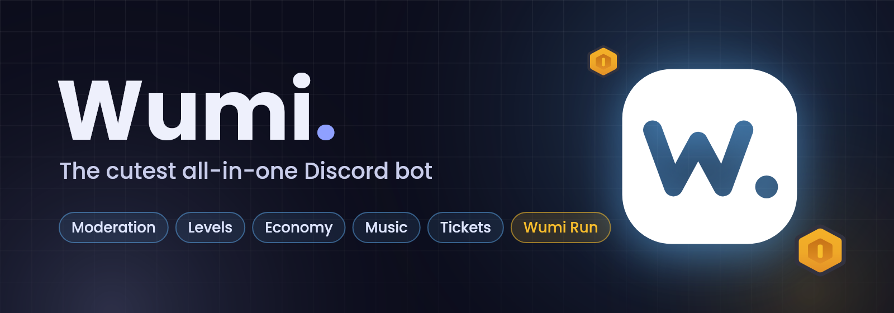
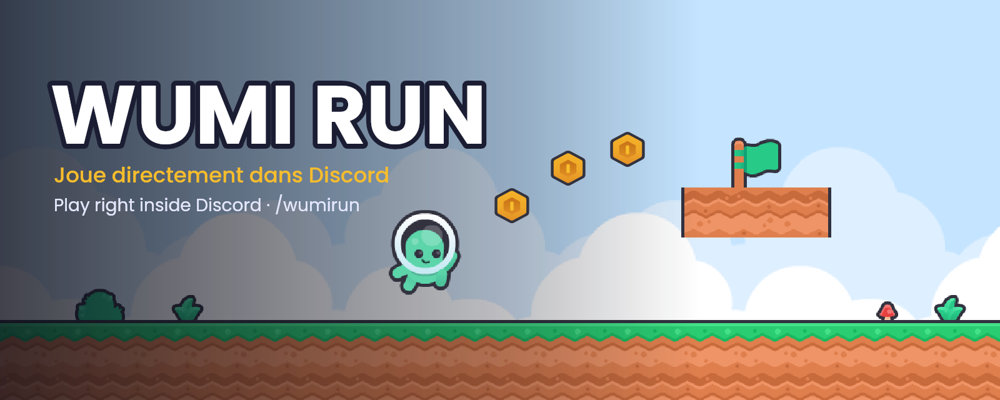
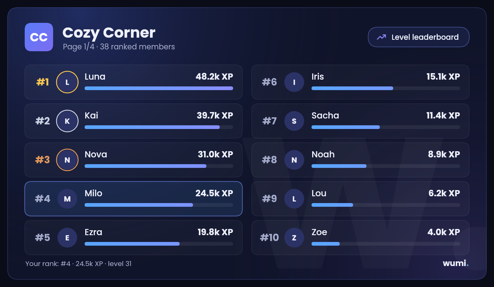
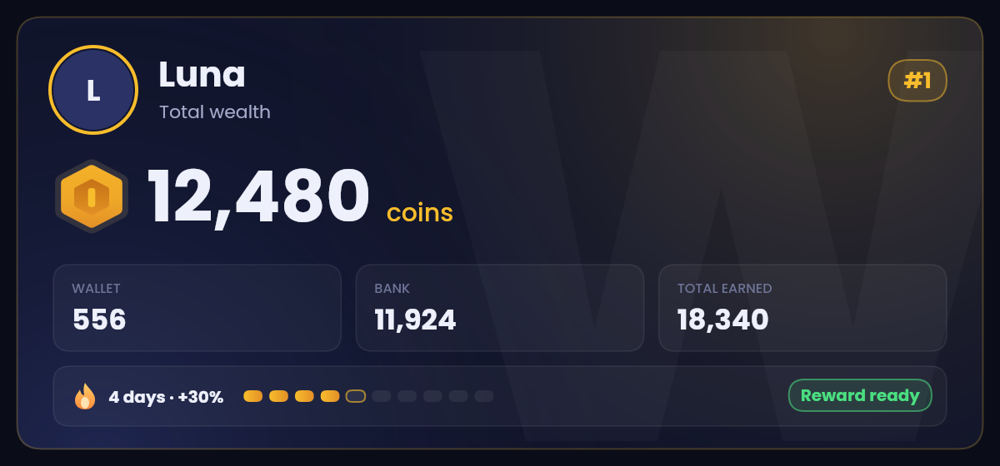
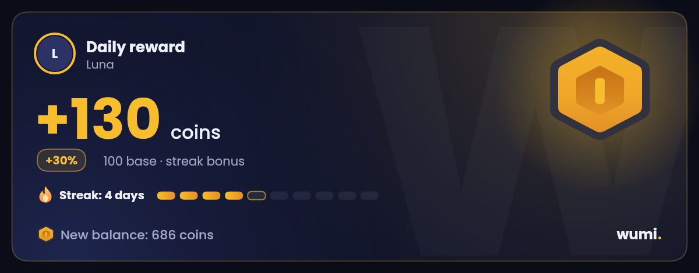
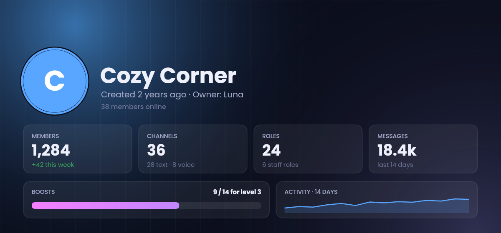
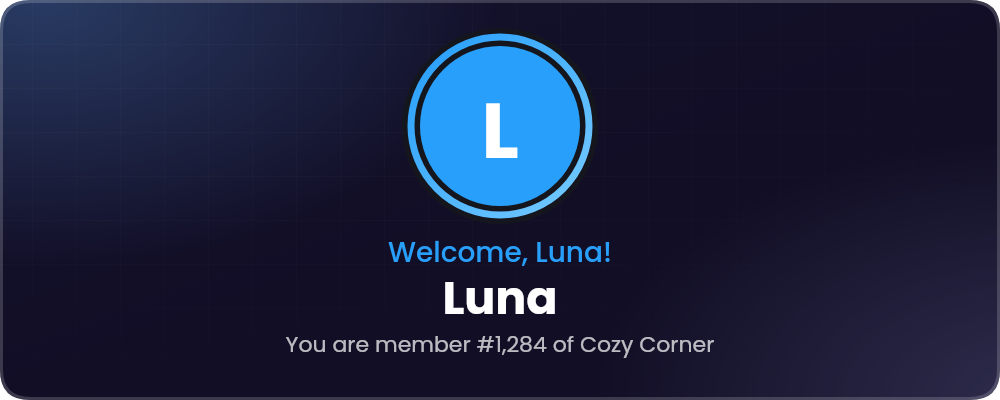

<div align="center">



<br>

**English** · [Français](README.fr.md)

<br>

[](https://discord.com/oauth2/authorize?client_id=1545770920185045084&scope=bot%20applications.commands&permissions=1426362592470)
[](https://wumi.fr)
[](https://discord.gg/VaGrXgnAHS)


</div>

---

**Wumi** is an all-in-one Discord bot that welcomes newcomers, keeps your server safe, rewards your regulars, plays music, runs your tickets, and even comes with its own game you play right inside Discord. Everything is a slash command, every message follows your server's language (English or French), and nothing asks for the Administrator permission.

## ✨ Highlights

<table>
<tr>
<td width="50%" valign="top">

### 🎮 Wumi Run
A real platformer, launched with `/wumirun play` as a Discord Activity. 5 levels, coins, stars, unlockable characters, and a best-times leaderboard for every server.

</td>
<td width="50%" valign="top">

### 🛡️ Anti-nuke
If an admin or a bot deletes channels or roles, or bans in a burst, Wumi strips their roles instantly and sends the owner a report with the fix.

</td>
</tr>
<tr>
<td valign="top">

### 🪙 Economy
Daily rewards with streaks, work, a bank, a shop and missions. Every answer is an image card with quick buttons underneath.

</td>
<td valign="top">

### 📈 Levels
XP for messages and voice time, rank cards, image leaderboards, badges, prestige and a monthly `/wrapped`.

</td>
</tr>
<tr>
<td valign="top">

### 🎫 Tickets & modmail
Auto-claim on the first staff reply, alerts for unanswered tickets, transcripts, ratings and `/ticket stats`. DM Wumi to reach the staff.

</td>
<td valign="top">

### 🔨 Moderation
Right-click a member › **Sanction**, warnings with automatic steps, automod, anti-raid, anti-phishing and translated logs that show who did what.

</td>
</tr>
</table>

## 🖼️ A look inside

<div align="center">

<sub><b>Wumi Run</b>: the platformer that opens right in your channel.</sub>
<br><br>

<sub><code>/leaderboard</code>: two columns, progress bars, your own rank highlighted.</sub>
<br><br>
 
<sub><code>/economy balance</code> and <code>/economy daily</code>, with the Wumi Run gold coin.</sub>
<br><br>
 
<sub><code>/serverinfo</code> and a welcome card (up to 5 custom designs per server).</sub>
</div>

## 📚 Everything Wumi can do

| Category | What's inside |
|---|---|
| 🎮 **Games** | Wumi Run (Discord Activity), Connect Four, tic-tac-toe, hangman, flag quiz and trivia, blind test, counting channel, `/pet`, `/lfg` |
| 🪙 **Economy** | Daily reward with streak bonus, work, bank with interest, shop with roles, items, missions, `/pay`, `/rob`, leaderboard |
| 📈 **Levels** | XP (messages and voice), rank and profile cards, themes, badges, prestige, role rewards, global leaderboard, `/wrapped` |
| 🔨 **Moderation** | warn, mute, kick, ban, softban, massban, purge, lock, slowmode, history, staff notes, appeals, `/snipe`, right-click sanctions |
| 🛡️ **Security** | `/antinuke`, `/raid` panic button, anti-raid, automod, anti-phishing, `/audit` (score out of 100), structure snapshots and repair |
| 🎫 **Support** | Tickets with panels, claim and transcripts, modmail, suggestions with voting, staff applications |
| 👋 **Community** | Welcome and goodbye cards, auto roles, reaction roles, starboard, birthdays, giveaways with bonus chances, recurring events |
| 🎵 **Music** | `/play` (YouTube, Spotify, SoundCloud), radios, filters, DJ role, playlists, 24/7 |
| 🧰 **Utilities** | `/embed` builder with templates, server and user cards, `/stats` with a Monday report, invites tracking, temporary voice channels, Twitch / YouTube / RSS alerts |

> The full, always up-to-date list lives on **[wumi.fr/commandes](https://wumi.fr/commandes/)**: it's generated from the bot itself.

## 🚀 Self-hosting

**You need:** Node.js **22.5 or newer** (24 recommended) and a Discord application from the [Developer Portal](https://discord.com/developers/applications).

```bash
git clone https://github.com/WumiTeam/Wumi-Bot.git
cd Wumi-Bot
npm install
cp .env.example .env      # then fill in DISCORD_TOKEN, CLIENT_ID, OWNER_IDS...
npm run deploy            # registers the slash commands
npm start
```

- The database is **SQLite built into Node**: nothing to compile, nothing to install.
- Every variable is documented in [`.env.example`](.env.example).
- In production, use [PM2](https://pm2.keymetrics.io/) with `ecosystem.config.js`, or `scripts/windows/demarrer.bat` on Windows.
- Optional services (music with Lavalink, the web dashboard, the Activity, Twitch, Instagram...) each have a guide in [`docs/guides`](docs/guides).
- `npm test` runs the test suite.

<details>
<summary><b>Project structure</b></summary>

```
src/
├── commands/      one file per slash command, sorted by category
├── events/        Discord events (messages, members, interactions, audit log...)
├── utils/         features: economy, tickets, anti-nuke, image cards...
├── langues/       en.json and fr.json, every text of the bot
├── database/      SQLite schema and queries
├── public/        public server: the Activity, Wumi Run, status API
├── musique/       music player (Lavalink)
└── assets/        fonts, banners, custom emojis
outils/            scripts: banners, command list, Wumi Run build...
test/              node:test suites
docs/              guides and README pictures
```
</details>

## 🧱 Built with

[discord.js v14](https://discord.js.org) with Components V2 · `node:sqlite` · [@napi-rs/canvas](https://github.com/Brooooooklyn/canvas) for every image card · the Discord Embedded App SDK for Wumi Run · [Poppins](https://fonts.google.com/specimen/Poppins) · game art by [Kenney](https://kenney.nl) (CC0).

## 💙 Links

- 🌐 Website: [wumi.fr](https://wumi.fr) · [What's new](https://wumi.fr/nouveautes/) · [Status](https://wumi.fr/statut/)
- 💬 Support server: [discord.gg/VaGrXgnAHS](https://discord.gg/VaGrXgnAHS)
- 🎵 TikTok: [@wumi.fr](https://www.tiktok.com/@wumi.fr)
- 📜 [Terms](CONDITIONS.md) · [Privacy policy](CONFIDENTIALITE.md) · [Changelog](CHANGELOG.md) · [Security](SECURITY.md)

<div align="center">
<br>
<sub>Made with 💙 by <b>Zhaak</b> · released under the <a href="LICENSE">MIT license</a></sub>
</div>
